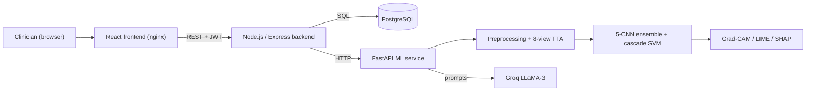

# Ocula: A XAI-Powered Diabetic Retinopathy Screening Platform with Hybrid CNN Ensemble

Demo Video: https://drive.google.com/file/d/1jLHvukq_FeU0jYUKN8M2SfiLpjbrRH7P/view?usp=sharing


Ocula is a full-stack medical imaging system that screens retinal fundus images for diabetic retinopathy (DR). It combines a five-backbone deep learning ensemble with a cascade SVM grader, three explainability methods (Grad-CAM, LIME, SHAP), LLM-generated clinical and patient reports, secure REST APIs and a clinician-focused web interface.

> **Status:** Core system complete and deployable via Docker Compose. Associated manuscript submitted to IEEE Techcon 2026.

> **Medical disclaimer:** Ocula is a research and educational project. It is **not** a certified medical device and must not be used as a substitute for examination by a qualified ophthalmologist.

---

## Table of Contents

1. [Key Results](#key-results)
2. [Features](#features)
3. [System Architecture](#system-architecture)
4. [ML Pipeline](#ml-pipeline)
5. [Tech Stack](#tech-stack)
6. [Repository Structure](#repository-structure)
7. [Getting Started](#getting-started)
8. [Configuration](#configuration)
9. [Usage](#usage)
10. [API Overview](#api-overview)
11. [Training and Reproducibility](#training-and-reproducibility)
12. [Deployment](#deployment)
13. [Security and Privacy](#security-and-privacy)
14. [Troubleshooting](#troubleshooting)
15. [Development Workflow](#development-workflow)
16. [Limitations](#limitations)
17. [Roadmap](#roadmap)
18. [References](#references)
19. [Author and Acknowledgements](#author-and-acknowledgements)
20. [License](#license)

---

## Key Results

Evaluated on the **APTOS 2019 Blindness Detection** dataset (five DR severity grades, 0–4).

| Task | Ocula | Butt et al. (2022) baseline |
|------|-------|-----------------------------|
| Binary (DR vs. no DR) accuracy | **98.50%** | 97.8% |
| Multiclass (5-grade) accuracy | **90.68%** | 89.29% |

The baseline is the hybrid GoogLeNet + ResNet-18 feature-fusion method published in *Diagnostics* 2022, 12, 1607 (see [References](#references)). Ocula extends that idea with a larger backbone set, test-time augmentation, imbalance handling, a cascade SVM grader and a full explainability and reporting layer.

---

## Features

- **Two-level screening:** binary DR detection plus five-grade severity classification.
- **5-CNN ensemble:** ResNet-18, GoogLeNet, EfficientNet-B4, DenseNet-121 and ConvNeXt-Tiny.
- **8-view test-time augmentation (TTA)** for stable predictions.
- **Class-imbalance handling** with ADASYN.
- **Cascade SVM grading** on the extracted deep features.
- **Explainable AI:** Grad-CAM heatmaps, LIME superpixel explanations and SHAP attributions for every prediction.
- **Dual-format reports** generated with Groq-hosted LLaMA-3: a clinician-facing report and a patient-friendly report.
- **Secure web application:** JWT authentication, bcrypt password hashing, PostgreSQL persistence.
- **Containerised stack:** one `docker compose` command brings up every service.
- **Distributed deployment ready:** the ML service can be hosted separately from the lightweight frontend, gateway and database.

---

## System Architecture



**Request flow**

1. The clinician logs in and uploads a fundus image through the React interface.
2. The Express backend authenticates the request (JWT), stores metadata in PostgreSQL and forwards the image to the ML service.
3. The ML service preprocesses the image, runs the ensemble with TTA, grades severity with the cascade SVM and produces the explanation maps.
4. The LLM layer turns the prediction and explanation summary into a clinical report and a patient report.
5. The backend persists the result and returns it to the frontend for display.

<!-- VERIFY: confirm whether the Groq call is made from the ML service (as drawn) or from the backend, and update the diagram and step 4 accordingly. -->

| Service | Responsibility | Default port |
|---------|----------------|--------------|
| `frontend` | React single-page app served by nginx | 3000 |
| `backend` | Express API gateway: auth, validation, persistence, orchestration | 5000 |
| `ml-service` | FastAPI inference, explainability and report generation | 8000 |
| `db` | PostgreSQL | 5432 |

<!-- VERIFY: service names and ports must match docker-compose.yml. -->

---

## ML Pipeline

### 1. Preprocessing

Fundus images are resized and normalised before feature extraction. The **exact same preprocessing** (resize, crop, normalisation constants) must be applied at training time and inference time. Mismatches between the two were the most common source of silent accuracy loss during development.

### 2. Backbones and feature extraction

| Backbone | Notes |
|----------|-------|
| ResNet-18 | Residual baseline, also used in Butt et al. (2022) |
| GoogLeNet | Inception-style multi-scale features, also used in Butt et al. (2022) |
| EfficientNet-B4 | Compound-scaled CNN |
| DenseNet-121 | Dense connectivity for feature reuse |
| ConvNeXt-Tiny | Modernised ConvNet; classifier head is replaced with `nn.Identity()` at `m.classifier[2]` to expose features |

Pre-trained backbones are fine-tuned on APTOS 2019, and their features are extracted and cached for the downstream SVM stage.

### 3. Imbalance handling and grading

- **ADASYN** oversamples minority severity classes in the training feature space.
- A **cascade SVM** consumes the fused deep features to produce the binary decision and the severity grade.

### 4. Test-time augmentation

Each image is evaluated under **8 views** and the outputs are aggregated, which reduces variance from framing and orientation.

### 5. Explainability

| Method | What it shows |
|--------|---------------|
| Grad-CAM | Spatial heatmap of regions driving the CNN decision |
| LIME | Superpixel-level local surrogate explanation |
| SHAP | Feature-level attribution for the prediction |

Explainability is a core deliverable of the platform, not an optional add-on. Every prediction returned by the API includes explanation artifacts.

### 6. Report generation

Two prompts are sent to Groq-hosted LLaMA-3 with the predicted grade, confidence and explanation summary:

- **Clinical report:** structured, terminology-rich summary for the clinician.
- **Patient report:** plain-language explanation and suggested next steps.

---

## Tech Stack

| Layer | Technologies |
|-------|--------------|
| ML / training | PyTorch, scikit-learn, imbalanced-learn (ADASYN), XGBoost (experiments), SHAP, LIME, Grad-CAM |
| ML service | FastAPI, Uvicorn |
| Backend | Node.js, Express, JWT, bcryptjs |
| Database | PostgreSQL |
| Frontend | React, nginx |
| LLM | Groq API (LLaMA-3) |
| Infrastructure | Docker, Docker Compose |
| Training environment | Kaggle GPU notebooks |

---

## Repository Structure

<!-- VERIFY: adjust folder names to match the actual repository layout. -->

```
.
├── frontend/            # React application (served by nginx in production)
├── backend/             # Node.js / Express API gateway
├── ml-service/          # FastAPI app, model loading, inference, XAI, reports
├── notebooks/           # Training and experiment notebooks (Kaggle pipeline versions)
├── docker-compose.yml   # Multi-service orchestration
├── .env.example         # Template for required environment variables
├── .gitignore
└── README.md
```

Large artifacts (model weights, cached `.npy` features, datasets) should be kept out of Git and supplied through Docker volumes or external storage.

---

## Getting Started

### Prerequisites

| Requirement | Version / notes |
|-------------|-----------------|
| Docker + Docker Compose | Recent version with the `docker compose` plugin |
| RAM | **At least 8 GB available** for the ML service |
| Groq API key | Required for report generation |
| Trained model artifacts | Backbone weights, SVM models and scaler (see [Model artifacts](#model-artifacts)) |

For local (non-Docker) development you also need Node.js 18+ and Python 3.10+.

### Quick start (Docker Compose)

```bash
# 1. Clone and enter the repository
git clone <your-repo-url>
cd <repo-folder>

# 2. Create your environment file and fill in the values
cp .env.example .env

# 3. Place trained model artifacts where the ML service expects them
#    (see "Model artifacts" below)

# 4. Build and start everything
docker compose up --build
```

Open the frontend at `http://localhost:3000`. The ML service docs are served by FastAPI at `http://localhost:8000/docs`.

Stop the stack with `docker compose down`. Add `-v` only if you also want to delete named volumes (database data and cached backbone weights).

### Model artifacts

The ML service expects the trained pipeline components at startup:

- fine-tuned weights for the five backbones
- the fitted ADASYN-trained cascade SVM models
- the feature scaler and any label mappings

Mount them into the ML service container through a bind mount or named volume. Also set `TORCH_HOME` to a path backed by a **named Docker volume** so pre-trained backbone weights are not re-downloaded on every cold start.

<!-- VERIFY: document the exact artifact filenames and the mount path used in docker-compose.yml. -->

### Running services individually (development)

**ML service**

```bash
cd ml-service
python -m venv .venv
source .venv/bin/activate          # Windows: .venv\Scripts\activate
pip install -r requirements.txt
uvicorn main:app --reload --port 8000
```

**Backend**

```bash
cd backend
npm install
npm run dev
```

**Frontend**

```bash
cd frontend
npm install
npm start
```

<!-- VERIFY: entry-point module name (main:app) and npm script names. -->

---

## Configuration

Create `.env` from `.env.example`. The file is git-ignored; never commit real secrets.

| Variable | Used by | Purpose |
|----------|---------|---------|
| `POSTGRES_USER`, `POSTGRES_PASSWORD`, `POSTGRES_DB` | db, backend | Database credentials |
| `DATABASE_URL` | backend | PostgreSQL connection string |
| `JWT_SECRET` | backend | Secret for signing access tokens |
| `ML_SERVICE_URL` | backend | Internal URL of the FastAPI service |
| `GROQ_API_KEY` | ml-service | Groq API credential for report generation |
| `TORCH_HOME` | ml-service | Cache directory for pre-trained backbone weights (back with a named volume) |
| `REACT_APP_API_URL` | frontend | Public URL of the backend API |

<!-- VERIFY: align variable names with the code and docker-compose.yml. -->

---

## Usage

1. **Register / log in** to the web interface.
2. **Upload** a retinal fundus image (JPEG or PNG).
3. Wait for the analysis to finish. The ML service is the slowest step because it runs TTA across five backbones plus the explainability methods.
4. **Review the result:** binary screening outcome, severity grade, confidence, and the Grad-CAM / LIME / SHAP visualisations.
5. **Read or export the reports:** the clinical report for the record and the patient report for communication with the patient.
6. Past analyses are available from the patient history view.

---

## API Overview

<!-- VERIFY: the endpoints below describe the intended contract; align paths and payloads with the actual route definitions. -->

**Backend (Express), authenticated with `Authorization: Bearer <JWT>`**

| Method | Endpoint | Description |
|--------|----------|-------------|
| POST | `/api/auth/register` | Create a user account |
| POST | `/api/auth/login` | Obtain a JWT |
| POST | `/api/predict` | Upload a fundus image and run the full analysis |
| GET | `/api/results` | List stored analyses for the current user |
| GET | `/api/results/:id` | Retrieve one analysis with explanations and reports |

**ML service (FastAPI, internal)**

| Method | Endpoint | Description |
|--------|----------|-------------|
| GET | `/health` | Liveness and model-loaded check |
| POST | `/predict` | Inference, explainability maps and report text for one image |

Interactive documentation for the ML service is available at `/docs`.

---

## Training and Reproducibility

- **Dataset:** [APTOS 2019 Blindness Detection](https://www.kaggle.com/c/aptos2019-blindness-detection) (Kaggle). The dataset is not redistributed here; download it under its own terms.
- **Environment:** training runs on Kaggle GPU notebooks; full-stack development happens locally.
- **Pipeline versions:** experiments are numbered (v1 → v11). Each version's metrics are tracked in a comparison CSV so changes in accuracy can be traced to specific pipeline changes.
- **Feature caching:** extracted backbone features are saved with `np.save` and reloaded with `np.load`. This avoids re-running extraction and cut a roughly 9-hour run down substantially when iterating on the SVM stage.
- **Consistency checks before every run:** verify that preprocessing and normalisation are identical in training and inference code paths.
- **Artifact export:** save backbone weights, SVM models and the scaler together so the ML service loads a matching set.

---

## Deployment

Ocula can run as a single Docker Compose stack or be split across hosts.

| Component | Resource needs | Hosting suggestion |
|-----------|----------------|--------------------|
| ML service | **≥ 8 GB RAM**, CPU is workable, GPU optional | VM or container host with sufficient memory |
| Backend / gateway | Light | Free-tier container platform |
| Frontend (nginx) | Light | Free-tier static / container hosting |
| PostgreSQL | Light | Managed free-tier database |

Production checklist:

- Serve everything over HTTPS and restrict CORS to the frontend origin.
- Use strong, unique values for `JWT_SECRET` and database credentials.
- Back `TORCH_HOME` and the model artifact path with persistent volumes.
- Keep the ML service on a private network reachable only by the backend.
- Configure request-size limits for image uploads.

---

## Security and Privacy

- Passwords are hashed with bcrypt; sessions use signed JWTs.
- Secrets live in `.env`, which is git-ignored.
- Retinal images are health data. Do not commit patient images or exports, and apply the privacy regulations that apply to your deployment (for example HIPAA or GDPR) before using real patient data.
- Prompts sent to the external LLM contain predictions and explanation summaries, not raw patient identifiers. Keep it that way when extending the reports.

---

## Troubleshooting

| Symptom | Likely cause and fix |
|---------|----------------------|
| Backbone weights re-download on every container start | `TORCH_HOME` not set or not backed by a named volume |
| Error loading the saved ConvNeXt-Tiny weights | `build_backbone` must set `m.classifier[2] = nn.Identity()` rather than replacing the whole classifier, to match the saved state dict |
| Good validation accuracy but poor results in the app | Preprocessing or normalisation differs between training and inference; compare both code paths |
| ML service is killed or restarts | Insufficient memory; give the container at least 8 GB |
| Backend cannot reach the ML service | Wrong `ML_SERVICE_URL`; inside Compose use the service name, not `localhost` |
| Report generation fails | Missing or invalid `GROQ_API_KEY`, or Groq rate limits |
| Very slow notebook reruns | Reuse cached features (`np.load`) instead of re-extracting |

---

## Development Workflow

- Branching: work on `dev`, merge into `main` when stable.
- Keep `.env`, datasets, weights and build output out of Git (see `.gitignore`).
- Before opening a merge, confirm the stack builds cleanly with `docker compose up --build`.
- When changing preprocessing or the backbone set, retrain or re-export artifacts and re-run the consistency check.

---

## Limitations

- Trained and evaluated on a single public dataset (APTOS 2019); performance on other cameras, populations and image qualities is not established.
- Not clinically validated and not approved as a medical device.
- LLM-generated reports can contain errors and must be reviewed by a clinician.
- Inference is heavy because of TTA across five backbones and three explainability methods.

---

## Roadmap

- [ ] External validation on additional DR datasets
- [ ] Probability calibration of the ensemble and SVM outputs
- [ ] Faster inference (batching, model quantisation, optional GPU serving)
- [ ] Automated test suite and CI pipeline
- [ ] Extension of the reusable pipeline (ensemble, ADASYN, cascade SVM, XAI stack) to other medical imaging modalities

---

## References

1. M. M. Butt, D. N. F. A. Iskandar, S. E. Abdelhamid, G. Latif and R. Alghazo, "Diabetic Retinopathy Detection from Fundus Images of the Eye Using Hybrid Deep Learning Features," *Diagnostics*, vol. 12, no. 7, p. 1607, 2022. https://doi.org/10.3390/diagnostics12071607
2. R. R. Selvaraju et al., "Grad-CAM: Visual Explanations from Deep Networks via Gradient-Based Localization," *ICCV*, 2017.
3. M. T. Ribeiro, S. Singh and C. Guestrin, "'Why Should I Trust You?': Explaining the Predictions of Any Classifier," *KDD*, 2016. (LIME)
4. S. M. Lundberg and S.-I. Lee, "A Unified Approach to Interpreting Model Predictions," *NeurIPS*, 2017. (SHAP)
5. H. He, Y. Bai, E. A. Garcia and S. Li, "ADASYN: Adaptive Synthetic Sampling Approach for Imbalanced Learning," *IJCNN*, 2008.
6. Z. Liu et al., "A ConvNet for the 2020s," *CVPR*, 2022. (ConvNeXt)
7. Kaggle, "APTOS 2019 Blindness Detection" dataset.

---

## Author and Acknowledgements

**Om Bhardwaj** — B.Tech CSE (AI & Data Science), IIIT Manipur.

Developed under the supervision of Dr. Rajkumari Bidyalakshmi Devi. Thanks to the open-source communities behind PyTorch, FastAPI, React, SHAP and LIME, and to the organisers of the APTOS 2019 challenge.

---

## License

<!-- VERIFY: choose and add a LICENSE file (e.g., MIT or Apache-2.0), then state it here. -->

License to be specified.
